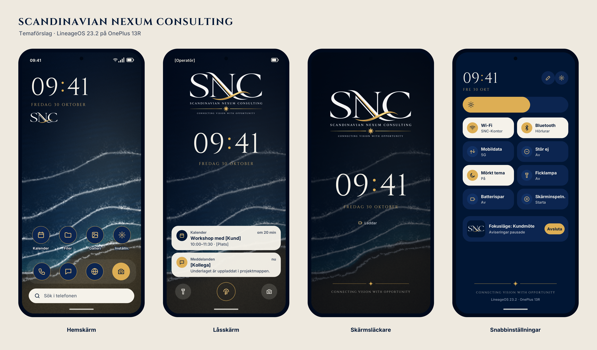

# SNC Theme

Tema för **Scandinavian Nexum Consulting** på OnePlus 13R med LineageOS 23.2.



## Appen (APK)

Ladda ner senaste `SNC-Tema-*.apk` under [Releases](https://github.com/menola8803/SNC-Theme/releases/latest) och installera den på telefonen (tillåt installation från okända källor).

Appen innehåller:

- **Bakgrunder:** ställer in strandbilden på hemskärmen och logga-bilden på låsskärmen med en knapptryckning.
- **Skärmsläckaren SNC Klocka:** loggan, klockan i Cinzel med guldkolon, datum och slogan. Aktivera den under Inställningar → Skärm → Skärmsläckare.
- **Klockwidgeten SNC Klocka:** klockan och datumet i Cinzel med guldkolon samt monogrammet. Håll fingret på hemskärmen → Widgetar → SNC Tema.

APK:n byggs automatiskt av GitHub Actions (`.github/workflows/build-apk.yml`) varje gång något i `android/` ändras, och publiceras som en ny release.

## Innehåll

| Mapp | Vad |
|---|---|
| `bakgrunder/` | Bakgrundsbilder i 1264 × 2780 (OnePlus 13R:s upplösning) |
| `logga/` | Loggan i original, transparent helversion och transparent SNC-monogram |
| `typsnitt/` | Cinzel (fritt under SIL Open Font License, se `Cinzel-OFL.txt`) |
| `skisser/` | Översiktsbild av temat |
| `kallkod/` | Python-skripten som ritade skissen och strandbakgrunden |

## Färger och typsnitt

| Roll | Värde |
|---|---|
| Bakgrund (marinblå) | `#011634` |
| Ytor | `#0C2550` |
| Guld (accent) | `#DDAE54` |
| Ljust guld | `#E9C27A` |
| Benvitt (text) | `#F5F2EA` |
| Klocka och rubriker | Cinzel |
| Brödtext | Inter |

## Installera bakgrunderna

1. Kopiera filerna i `bakgrunder/` till telefonen.
2. Håll fingret på hemskärmen och välj **Bakgrunder**.
3. Välj `strand-natt_1264x2780.png` för hemskärmen och `skarmslackare-logga_1264x2780.png` för låsskärmen.

## Guide: klockan i Cinzel och guld med KWGT

LineageOS låter dig inte byta typsnitt eller färg på systemklockan. Med widgetappen KWGT kan du lägga en egen klocka på hemskärmen.

### 1. Installera KWGT
Installera **KWGT Kustom Widget Maker** från Google Play eller Aurora Store. Vissa funktioner kan kräva KWGT Pro.

### 2. Lägg in typsnittet
1. Öppna filhanteraren på telefonen.
2. Skapa mappen `Kustom/fonts` i internminnet om den inte finns.
3. Kopiera `typsnitt/Cinzel.ttf` dit.
4. Kopiera även `logga/snc-monogram-transparent.png` till telefonen, till exempel till `Pictures`.

### 3. Placera en widget
1. Håll fingret på hemskärmen och välj **Widgetar**.
2. Dra ut en **KWGT**-widget i storlek 4 × 2 till toppen av skärmen.
3. Tryck på den tomma widgeten för att öppna redigeraren.

### 4. Klockan
1. Tryck på **+** och välj **Text**.
2. Under **Text**, skriv:
   ```
   $df(HH)$[c=#DDAE54]:[/c]$df(mm)$
   ```
3. **Font:** Cinzel.
4. **Size:** cirka 70.
5. **Color:** `#F5F2EA`.

Kolonet blir guld och siffrorna benvita.

### 5. Datumet
1. Tryck på **+** och välj **Text** igen.
2. Skriv:
   ```
   $tc(up, df(EEEE d MMMM))$
   ```
3. **Font:** Cinzel.
4. **Size:** cirka 14.
5. **Color:** `#DDAE54`.

### 6. Monogrammet
1. Tryck på **+** och välj **Image**.
2. Välj `snc-monogram-transparent.png`.
3. Ställ in bredden till ungefär en tredjedel av klockans bredd.

### 7. Ordna och spara
1. Lägg elementen under varandra: klocka, datum, monogram.
2. Ställ in **Layout** till vänsterjusterat.
3. Tryck på disketten uppe till höger för att spara.

### 8. Ta bort standardklockan
Om hemskärmen redan visar en klocka eller ett datum, ta bort den widgeten så att bara SNC-klockan syns.

## Låsskärm och skärmsläckare

Låsskärmens klocka och skärmsläckaren går inte att styla med KWGT. Använd bilden `skarmslackare-logga_1264x2780.png` som låsskärmsbakgrund, så syns loggan där. Klocktypsnittet följer då LineageOS standard.
